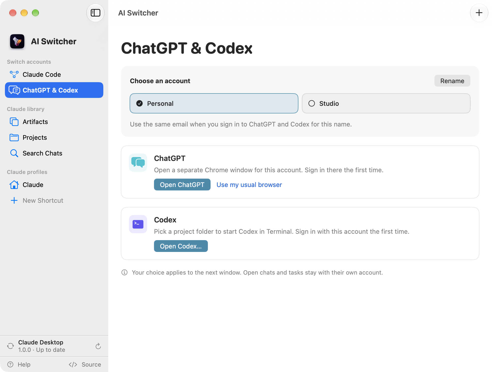

# AI Switcher

AI Switcher shows which account answered a Claude Code request in Claude Desktop. On a compatible connection, you can turn on automatic switching or pick one account to use. You can also open ChatGPT or start a new Codex task in the OpenAI desktop app using a folder on your Mac.

[Download for macOS](https://github.com/moonlitnayeem/claude-switcher/releases/latest) · [All releases](https://github.com/moonlitnayeem/claude-switcher/releases) · [Report a problem](https://github.com/moonlitnayeem/claude-switcher/issues)

## Do I need Graft?

**If your Claude Desktop account list shows “Manage in Graft”, keep Graft installed and running.** Graft switches eligible requests to a backup when your main account hits a limit. AI Switcher shows which account answered. Installing AI Switcher or turning off **Use my existing Graft setup** does not move that connection.

AI Switcher opens on its own and includes a local relay for separately configured Claude Desktop profiles. For a personal subscription, Anthropic supports signing in directly to Claude Code. Its rules prohibit third-party products from routing users’ requests through their personal subscription credentials. The bundled relay does not provide a supported way to move an existing subscription chat off Graft. [Anthropic’s authentication and credential rules](https://code.claude.com/docs/en/legal-and-compliance#authentication-and-credential-use)

The ChatGPT and Codex desktop actions and the optional browser and Terminal profiles work without Graft. To switch accounts in the OpenAI desktop app, use that app’s account controls.

## Install

Open the DMG, drag **AI Switcher** to **Applications**, then open it. The app supports Apple silicon and Intel Macs running macOS 13 or later. Automatic switching for Claude Code requires Claude Desktop and macOS 15 or later.

## Use Claude Code in Claude Desktop with Graft

1. Keep Graft running. In **AI Switcher → Settings**, turn on **Use my existing Graft setup**. This option appears when Switcher finds Graft’s saved setup.
2. Quit and reopen **AI Switcher**. Open **Claude Desktop** in its sidebar. Your main account comes first. If Graft also lists that sign-in as a backup, AI Switcher shows it once, under **Main**. The other accounts appear under **Backup**. Graft keeps its sign-ins and its existing connection to Claude.
3. Look for **Automatic switching** beside the account map. On lets the connection use its normal account choices. Off uses only the main account. Under **Your accounts**, choose **Use only this account** to stay on a particular backup. This applies to new Claude Code model requests from every chat in the selected profile. If the chosen account is full or cannot handle the request, the request stops there. Turn Automatic switching back on to go back to the usual routing.
4. Choose **Rename label** beside an account, type a nickname such as “Work”, then choose **Save label**. Leave the label empty to use the original name again. The nickname is saved on this Mac. Choose **Manage in Graft** to add or remove a backup or change a saved per-chat preference. A profile-wide account lock takes precedence over that preference.

These controls require support from the helper that serves the window. Older Graft helpers still report activity. The AI Switcher installer updates its own helper only.

On the main profile, choose **Open Claude Desktop** to continue in the installed app. In this setup, Graft handles each eligible Claude Code request sent through its existing connection. AI Switcher reads its status about once a second while the map is open. You can keep working in the same Claude window with the connection Graft already installed.

The globe slowly turns while the map is visible. A pulse along a line means Graft reported a recent reply. **Recent activity** names the account and model that answered. If a chat has a saved backup choice, that backup can answer even before the main account reaches a limit. Turn on macOS **Reduce Motion** to hold the globe still and read the same account status in text.

## Profiles managed by AI Switcher

For a profile already connected directly to AI Switcher, the **Account map** and **Recent activity** show what Switcher’s bundled relay handled. **Rename label** gives an account a nickname on this Mac. **Remove backup** takes the account out of that profile’s list and keeps its saved sign-in. **Forget a saved sign-in…** removes an unused sign-in after confirmation. The same **Automatic switching** and **Use only this account** controls work with the bundled helper. Your list of backups stays saved in either mode.

### Use Claude Code in Terminal

On the main Claude profile, open **More → Open Claude Code in Terminal…** and pick a local project folder. The Claude CLI uses its regular Terminal sign-in and settings. The account map follows Claude Desktop’s connection. Opening Terminal leaves that connection in place.

### Check a model’s latest limit

Open **Claude Desktop → Your accounts → Refresh**. The time beneath the button tells you when AI Switcher last read the relay. Each dated weekly reading tells you when that account’s usage was last seen. An account reset can be newer than its reading. Refresh reads the local status without sending a model request.

Under **Recent activity**, a model is listed if its latest recorded request returned a rate limit. A later reply from a different model leaves that entry visible. A newer result for the same model updates it. The list covers the recent requests the relay still has for this profile, including Fable, Mythos and other named models.

### When Fable reaches its limit

Switcher keeps the model you chose, including Fable 5.2. An account can have weekly usage left and still be out of Fable usage. If you’ve reset that account’s allowance and its old reset time is still showing, choose **Recheck Fable** when offered. The next eligible Fable request checks that account once. Check for the queued confirmation. Some Graft versions skip the check at 99% overall weekly use or 98% overall five-hour use, even when Fable’s own allowance has been reset. In that case, AI Switcher shows what the relay reported. A Fable reply from the backup confirms that the account handled the request.

An eligible request can move to another account you’ve connected. Requests tied to an account-owned file, connector or thread can require that account. A saved account choice can also determine which account answers. If all eligible accounts decline Fable, Claude shows the provider’s limit. Claude Chat and Cowork keep using their own accounts.

## Use the OpenAI desktop app

Open **ChatGPT & Codex** in the sidebar. **Open desktop app** brings the OpenAI app forward so you can continue in your existing window without choosing a folder. Choose Codex or ChatGPT from the menu at the top left. The app uses its own signed-in account. If that account hits a usage limit, account switching is manual. [OpenAI desktop guide](https://learn.chatgpt.com/docs/app)

When you want to start a new task with files on your Mac, choose **New chat in folder…**. **New chat in last folder** starts another chat in the folder you picked last time. Files stay on disk, and existing chats and running tasks stay with the account that started them. Account choices under **Browser and Terminal profiles** apply to those optional tools.

### Browser and Terminal profiles

Expand **Browser and Terminal profiles** to use named accounts with Chrome and the Codex command-line app. Pick an account or choose **Add account** and give it a name, such as “Work”. Add as many profiles as you need. Your two AI Switcher 1.1 profiles, their names and sign-ins carry over.

- **Open in Chrome** opens chatgpt.com in a separate Chrome profile for the selected account. Sign in there the first time. To switch accounts inside a tab, use ChatGPT’s account menu. **Use my usual browser** opens ChatGPT in your regular browser. Chats, uploaded files, memory and settings stay with the ChatGPT account that owns them. [OpenAI’s account switching guide](https://help.openai.com/en/articles/20001068-using-multiple-chatgpt-accounts-on-web-and-mobile)
- **Open in Terminal…** starts the Codex command-line app. Pick a project folder, then sign in if prompted. Select another profile and choose **Use same folder** to start a new Terminal session under that account with the same local files.
- **Rename** changes a profile’s name. Under **Account options** (•••), **Remove from list…** hides it. **Removed accounts** lets you restore the profile with its sign-ins intact.

## Build and check

On macOS with the Swift toolchain, run `./build.sh`. The app is written to `build.noindex/AI Switcher.app`. Run the relevant checks from the repository root.

| Command | What it checks |
| --- | --- |
| `./test.sh` | App behavior and account selection rules |
| `./test-relay.sh` | Requests through a local relay with test accounts |
| `./test-graft-connection.sh` | Existing Graft setup, confirmed account controls and scoped Fable rechecks |
| `./test-openai.sh` | Desktop launch and project actions, named profiles and isolated Terminal sessions |
| `./test-layout.sh` | English and Russian windows and accessibility controls |

Release signing and notarization use `release.sh`. See the security guide for where each mode stores its data. [Security guide](SECURITY.md)

AI Switcher is an independent fork of Claude Graft for macOS. The original project was created by Aaditya Vitthal More and released under the MIT license. Claude and Claude Desktop are Anthropic products. ChatGPT and Codex are OpenAI products. [Original project](https://github.com/aaditya-v-more/claude-graft) · [Original website](https://aaditya-v-more.github.io/claude-graft/) · [Creator website](https://aadityamore.com/) · [GitHub](https://github.com/aaditya-v-more) · [LinkedIn](https://www.linkedin.com/in/aadityavmore/) · [MIT license](LICENSE)
