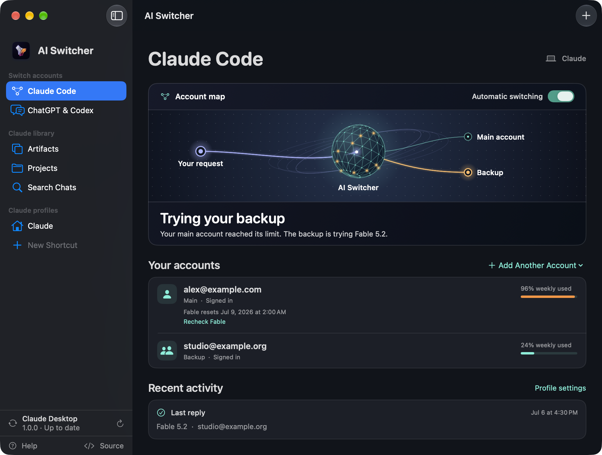

# AI Switcher

AI Switcher shows which account answered a Claude Code request in Claude Desktop, tracks live session, weekly, and Fable usage across your accounts, and lets you switch or launch accounts across Claude, ChatGPT & Codex, and Gemini & Antigravity from one place on your Mac.

[Download for macOS](https://github.com/moonlitnayeem/claude-switcher/releases/latest) · [All releases](https://github.com/moonlitnayeem/claude-switcher/releases) · [Report a problem](https://github.com/moonlitnayeem/claude-switcher/issues)

## Do I need Graft?

**If your Claude Desktop account list shows “Manage in Graft”, keep Graft installed and running.** Graft switches eligible requests to a backup when your main account hits a limit, and AI Switcher shows live usage, controls routing, and lets you add or launch accounts alongside it. Installing AI Switcher or turning off **Use my existing Graft setup** does not move an existing Graft connection.

AI Switcher also runs on its own without Graft and includes a bundled local relay for separately configured Claude Desktop profiles, plus standalone multi-account launchers for ChatGPT & Codex and Gemini & Antigravity. For a personal subscription, Anthropic supports signing in directly to Claude Code. Its rules prohibit third-party products from routing users’ requests through their personal subscription credentials. The bundled relay does not provide a supported way to move an existing subscription chat off Graft. [Anthropic’s authentication and credential rules](https://code.claude.com/docs/en/legal-and-compliance#authentication-and-credential-use)

## Install

Open the DMG, drag **AI Switcher** to **Applications**, then open it. All release builds are signed with a Developer ID certificate and notarized by Apple. The app supports Apple silicon and Intel Macs running macOS 13 or later. Automatic switching for Claude Code requires Claude Desktop and macOS 15 or later.

## Use Claude Code in Claude Desktop with Graft

1. Keep Graft running. In **AI Switcher → Settings**, turn on **Use my existing Graft setup**. This option appears automatically when Switcher finds Graft’s saved setup on your Mac.
2. Open **Claude Desktop** in the sidebar. Your main account appears first under **Main**, followed by each connected backup account under **Backup**.
3. Use **Automatic switching** beside the account map to let eligible Claude Code requests move automatically to a backup when your main account reaches a session, weekly, or model-specific limit, or choose **Use only this account** on any card to lock new Claude Code requests in that profile to a specific account.
4. Choose **Add account** beside **Refresh** to sign in and attach as many backup Claude accounts as you want directly inside AI Switcher. Signing in opens a local loopback browser flow so it never collides with running Claude Desktop windows, seals the login into your account pool, and reloads Graft’s controller in the background without interrupting `Claude.app` or active sessions. From the same menu you can re-attach previously saved accounts, remove a backup from the active profile while keeping its saved sign-in, or forget unused sign-ins.
5. Choose **Rename label** beside any account to save a local nickname such as “Work”, or **Manage in Graft** whenever you want to adjust per-chat preferences inside Graft itself.

On the main profile, choose **Open Claude Desktop** to continue in your installed app, or **More → Open Claude Code in Terminal…** to pick a local project folder for the Claude CLI.

## Live usage, Fable failover, and backup Chat & Cowork

Each account card tracks **Current session (5h)**, **Overall weekly**, and **Fable usage** separately, along with the source of each measurement and a live countdown to its reset window. AI Switcher reads live rate-limit headers from the relay—including Fable’s dedicated `7d_oi` utilization and reset timestamps—so model-specific allowances stay accurate even when overall weekly usage still has room, and warning headers (`allowed_warning` at 75% usage) keep routing smoothly without false lockouts. You can also choose **Update from Claude…** on any account card to paste percentages from your Claude Usage page, or **Recheck Fable** after resetting an allowance manually.

Claude Chat and Cowork tabs use their window’s own signed-in session rather than the Claude Code relay. Whenever your main account reaches its Fable limit, AI Switcher surfaces a one-click **Open Chat/Cowork on backup** callout right above your account cards (and an **Open Chat/Cowork** button on each backup card) to launch that backup account’s separate side-by-side Claude Desktop window without closing your main `Claude.app`. If a backup account does not have a separate profile bundle yet, choose **Create Chat/Cowork profile** to create one in `~/Applications`. For the initial one-time sign-in on a backup window while main Claude is already running, choose **Sign in backup…** to complete login inside AI Switcher’s isolated sign-in sheet—it intercepts the `claude://` callback and delivers it directly to the backup Claude process so you never have to quit your main window.

Under **Recent activity**, AI Switcher shows any model that hit a rate limit on its latest attempt, the last successful reply, per-account session reply totals, and an expandable **Recent requests** feed listing recent routed turns, models, and failover reasons. In the sidebar under **Claude library**, **Artifacts**, **Projects**, and **Search Chats** let you browse and search across your signed-in Claude accounts and local Claude Code transcripts in both Graft-connected and standalone modes.

## Menu bar HUD and smart notifications

When **Show in Menu Bar** is enabled, AI Switcher stays available in the macOS menu bar even when its main window is closed. In Graft-connected mode, the menu bar item optionally displays your active Fable percentage right beside the icon (**Show Fable % in Menu Bar**, switching to `B:…%` while a backup is serving Fable), lists live `5h`, `Week`, and `Fable` usage with reset countdowns for every account, and gives one-click access to **Automatic switching**, **Use only …** locks, **Add Another Claude Account…**, **Open Claude Desktop**, **Open Chat/Cowork on backup**, and **Open Antigravity / Gemini**.

When **Usage & Failover Notifications** is enabled in Settings or the menu bar, AI Switcher sends deduplicated macOS notifications when your main account hits 100% Fable or weekly usage and fails over to a backup, when a backup crosses 85%, 95%, or 100% Fable usage, and when a Fable or weekly window resets.

## Profiles managed directly by AI Switcher

For profiles configured directly in AI Switcher without Graft, the **Account map**, **Your accounts**, and **Recent activity** work with Switcher’s bundled local relay. Use **Add backup** to sign in additional accounts or share usage between local Claude profiles, **Rename label** to set a nickname, **Remove backup** to detach an account while keeping its saved login, and **Forget a saved sign-in…** to remove an unused login after confirmation.

## ChatGPT & Codex

Open **ChatGPT & Codex** in the sidebar. **Open desktop app** brings the OpenAI app forward so you can continue in your existing window, while **New chat in folder…** and **New chat in last folder** start a Codex task in a local folder on your Mac.

Expand **Browser and Terminal profiles** to manage as many named OpenAI profiles as you need. Choose **Add account** to create a slot such as “Work”, **Open in Chrome** to launch `chatgpt.com` in an isolated Chrome `--user-data-dir` profile for that account, or **Open in Terminal…** (and **Use same folder**) to launch the Codex CLI with its own isolated `CODEX_HOME` credentials on the same project files. Removed profiles keep their saved logins and can be restored anytime from **Removed accounts**.

## Gemini & Antigravity

Open **Gemini & Antigravity** in the sidebar to launch Google Antigravity / Gemini on your Mac and switch cleanly across multiple Google accounts. **Open Antigravity / Gemini** opens the installed desktop app, while **Open agy CLI in folder…** and **Open agy in last folder** start an Antigravity CLI (`agy`) session in Terminal for your chosen project directory, automatically passing `AGY_ACCOUNT` when you name a selected account slot to match your connected account.

Under **Multi-account Browser & CLI profiles**, add as many named Google account slots as you want. Each slot maintains its own isolated Chrome profile for **Open Gemini in Chrome** (`gemini.google.com`) and **Open AI Studio** (`aistudio.google.com`) so multiple Google accounts stay signed in side by side without tab collisions, along with its own isolated `GEMINI_CLI_HOME` directory for **Open Gemini CLI…** in Terminal.

## Build and check

On macOS with the Swift toolchain, run `./build.sh` to build `build.noindex/AI Switcher.app`. Run the verification suites from the repository root.

| Command | What it checks |
| --- | --- |
| `./test.sh` | App behavior, localization parity, alert transitions, and account inventory rules |
| `./test-relay.sh` | Requests, model-scoped rate limits, and failover behavior through a local relay |
| `./test-graft-connection.sh` | Existing Graft setup, live usage display, backup profile lookup, and scoped Fable rechecks |
| `./test-openai.sh` | Desktop launch and project actions, named profiles, and isolated Terminal sessions |
| `./test-layout.sh` | English and Russian windows, layout geometry, and accessibility controls |

Release signing and Apple notarization use `./release.sh --notarize`. See the security guide for where each mode stores its data. [Security guide](SECURITY.md)

AI Switcher is an independent fork of Claude Graft for macOS. The original project was created by Aaditya Vitthal More and released under the MIT license. Claude and Claude Desktop are Anthropic products. ChatGPT and Codex are OpenAI products. Gemini and Antigravity are Google products. [Original project](https://github.com/aaditya-v-more/claude-graft) · [Original website](https://aaditya-v-more.github.io/claude-graft/) · [Creator website](https://aadityamore.com/) · [GitHub](https://github.com/aaditya-v-more) · [LinkedIn](https://www.linkedin.com/in/aadityavmore/) · [MIT license](LICENSE)
